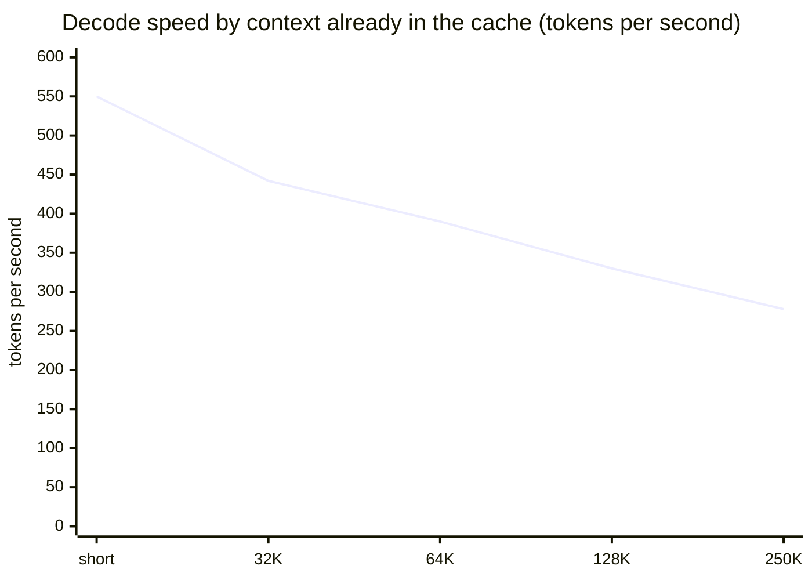
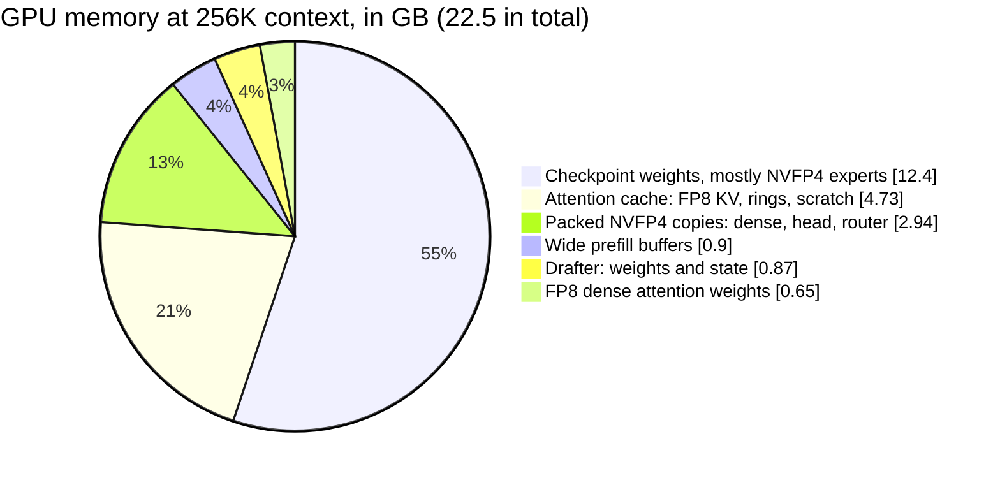
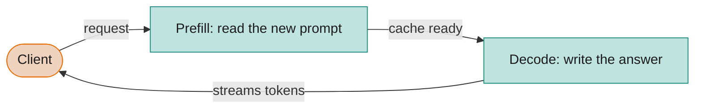

# inkling

A native Windows inference engine and OpenAI-compatible server for [Inkling 2 Mini](https://huggingface.co/thinkingmachines/Inkling-2-Mini),
written in Rust with GPU kernels in Rust ([cuda-oxide](https://github.com/NVIDIA/cuda-rust)). It is built for one
GPU, the **NVIDIA RTX 5090** (Blackwell, `sm_120a`), and for **long context**: with the full **256K-token** window
in use, it decodes at about **278 tokens/s**, reads a completely full 256K-token prompt (about a 600-page book) in about **55 seconds**, and fits in about
**22.5 GiB** of the card's 32 GB. At short context it decodes at about 550 tokens/s.

It gets there with:

* **FP8 dense attention and NVFP4 experts**, so the 20 GB checkpoint fits next to a long context in 32 GB;
* an **FP8 KV cache** (and an FP8 cache for the drafter), which is what makes 256K fit and keeps long-context decoding
  fast, because decoding is limited by how many bytes of cache each step reads;
* **DSpark speculative decoding** with an adaptive verify width (2, 4 or 8 tokens per step);
* **Wide prefill**, a batched prompt path for long prompts, with chunks up to 2,048 tokens.

`inkling serve` speaks the OpenAI chat API (streaming, reasoning, tool calls) and reuses the cache across turns,
so it works as the backend for coding agents such as [Pi](https://www.npmjs.com/package/@mariozechner/pi-coding-agent).

## Performance

Measured on one RTX 5090 (32 GB), Windows 11, CUDA 13.5, with the FP8 KV and drafter caches and speculative
decoding on, one request at a time, greedy decoding.

**Decoding speed, by how much context is already in the cache**

| Context | Decode speed | Time per step |
| --- | ---: | ---: |
| short (about 100 tokens) | about 550 tok/s | 5.5 ms |
| 32K tokens | 442 tok/s | 5.7 ms |
| 64K tokens | 390 tok/s | 6.0 ms |
| 128K tokens | 330 tok/s | 6.7 ms |
| 250K tokens | **278 tok/s** | 8.3 ms |



The slope is the cost of reading a longer cache at every step.

**Prefill, from an empty cache**

Prefill is the time to read the prompt before the first token appears. It grows with prompt length, so the 256K time is for a prompt that fills the window. A short prompt takes a fraction of a second, and a 10K-token prompt takes a little over a second.

| Prompt | Time | Rate |
| --- | ---: | ---: |
| 1K tokens | 0.14 to 0.21 s | about 4,800 tok/s |
| 10K tokens | 1.15 to 1.18 s | about 8,500 tok/s |
| 32K tokens | 3.8 to 3.9 s | about 8,400 tok/s |
| 64K tokens | 8.5 s | about 7,500 tok/s |
| 128K tokens | 20.3 to 20.6 s | about 6,250 tok/s |
| 256K tokens | 54.8 to 55.5 s | about 4,650 tok/s |

Every row was timed through the HTTP server on the current build (`scripts\prefill_bench.py run LABEL --speed ...`): three runs each, random-word prompts that cannot reuse the cache, one output token, so each time includes about one decode step. The rate falls at long context because attention reads a longer cache.

Later turns of a conversation do not pay this again. The server keeps the cache, so only the new tokens are
prefilled: a follow-up request that reused 80 of its 118 prompt tokens produced its first token in about 70 ms.

**Memory:** 22.5 GiB at 256K context, with the 20 GB checkpoint loaded. Each saved cache state (for turn reuse) adds
about 0.36 GB when used. The cache is allocated up front, so a smaller `max_ctx` uses less, by roughly 16 KiB for
every token of context removed (an estimate).



The checkpoint is most of it. The attention cache is the FP8 KV cache plus the sliding-window rings and scratch; the server's startup log lists it as "other decode state".

How to read these numbers:

* The decode rows are greedy decoding of 256 tokens after a prompt of that length, from repeated runs that alternate
  between builds so that drift does not bias them, with the GPU otherwise idle. Speed falls with context because each step reads the whole cache:
  at 250K the attention reads already run at roughly 90 to 96% of the card's memory bandwidth, so going faster needs
  fewer bytes, not faster kernels.
* Speculative decoding runs faster on predictable text. These prompts accepted about 2.3 tokens per step, which is a
  cautious case. Code and tool calls accept about 5 and ran at 520 to 660 tok/s in short-context requests I tried,
  and copy-like text runs faster still.
* FP8 caches trade a little numeric precision for the memory and speed. The output matches the reference model
  within the tolerances I checked, but past about 8K tokens the speculative output can differ from plain greedy
  decoding where two tokens are nearly tied.
* The decode rows were measured on a build slightly older than this code. Two later changes made decoding about
  1 to 2% faster, so they are if anything a little low. You can check short-context speed on your own machine with
  `target\release\inkling.exe bench`.

## Start here

On a new machine the only thing to install by hand is `uv`. Everything else is checked for you:


In commands:

```powershell
winget install --id astral-sh.uv -e
setup.cmd                 # or: uv run --script scripts\inkling.py doctor
```

`doctor` checks every tool the project needs (the NVIDIA driver, CUDA 13.5, the Visual Studio C++ tools, Rust, LLVM,
libffi, git, free disk space), says which step needs each one, and prints the `winget` command for every tool that is
missing, in the order to run them. It installs nothing itself. Run the commands it lists, open a **new** terminal so
the installs are on `PATH`, and run it again until it says everything is installed. `doctor --for run` checks only
what running the server needs, and the other commands refuse with the same recommendation when something they need
is missing.

## Quick start

```powershell
just doctor          # is everything installed? how to install what is missing
just status          # what is ready, and the next step
just weights         # download the checkpoint (about 20 GB) and verify it
just kernels         # build the GPU kernels from source (the first run fetches cuda-oxide)
just build           # build the engine
just serve           # start the server on http://127.0.0.1:8013/v1
```

Without `just`, run `uv run --script scripts\inkling.py <command>` (`status`, `weights`, `check-weights`,
`doctor`, `kernels`, `build`, `serve`, `stop`). `status` always tells you what to run next, and every command that cannot run
yet says why and what to do, so you can run them in any order and the tool will tell you.

In a terminal the commands show color, tables and a progress bar while hashing the weights, using
[Rich](https://github.com/Textualize/rich) (`uv` installs it on the first run, from the versions locked in
`scripts\inkling.py.lock`). Piped output, `--json` and any run with `NO_COLOR` set are plain text.

## Requirements

`just doctor` checks all of this and tells you how to install what is missing.

| | |
| --- | --- |
| GPU | NVIDIA RTX 5090. The kernels are compiled for `sm_120a`; other GPUs are refused. About 22.5 GiB of VRAM is used at 256K context |
| OS | Windows 11 x64 |
| Driver and CUDA | A current NVIDIA driver and the CUDA 13.5 Toolkit. `cublas64_13.dll` (in the Toolkit's `bin\x64`) must be on `PATH`, and the kernel build needs `nvcc` |
| Tools | [uv](https://docs.astral.sh/uv/) (`winget install astral-sh.uv`; it runs the scripts and brings its own Python), [rustup](https://rustup.rs) (the pinned Rust 1.99.1 installs itself), git, and [just](https://github.com/casey/just) (`winget install Casey.Just`, optional) |
| Build tools | Visual Studio 2022 or its Build Tools with the C++ workload; LLVM (`winget install LLVM.LLVM`); vcpkg with `libffi:x64-windows`. These are needed only for `just kernels` |
| Disk | About 20 GB for the weights |

## Get the weights

The weights are not part of this repository. `just weights` downloads the original checkpoint from Hugging Face,
[`thinkingmachines/Inkling-2-Mini`](https://huggingface.co/thinkingmachines/Inkling-2-Mini) (Apache-2.0), at the
revision this project was built against (`7a67ae23`), into `%USERPROFILE%\Models\Inkling-2-Mini`, and then checks
every file against the hashes Hugging Face publishes for that revision. The same download by hand:

```powershell
uvx --from huggingface_hub hf download thinkingmachines/Inkling-2-Mini `
    --revision 7a67ae2314b44ef05c87fd1d4d311c58aaeb18f6 `
    --local-dir "$env:USERPROFILE\Models\Inkling-2-Mini"
just check-weights
```

The download is about 20 GB: `model-00001-of-00001.safetensors` (19.5 GB), `mtp.safetensors` (0.6 GB, the
speculative drafter), the tokenizer and chat template, and the config files. An interrupted download resumes when
you run the command again. If the repository asks you to accept its terms first, run
`uvx --from huggingface_hub hf auth login` and try again. The engine reads the safetensors as published; nothing is
converted.

To keep the checkpoint elsewhere, set `INKLING_MODEL_DIR`, set `model_dir` in `serve.config.json`, or pass
`--model-dir`.

## Build

```powershell
just kernels         # the two GPU kernel files, into kernels\
just build           # target\release\inkling.exe
```

The host build takes under a minute. `just kernels` takes a few minutes the first time and under a minute after
that. It:

1. clones [cuda-oxide](https://github.com/NVIDIA/cuda-rust) into `third_party\cuda-rust` at the pinned commit
   (`5e5c77b19a4b3204d6542bab2f0fde2a4eed824b`) and applies `patches\cuda-rust-windows-lean.patch`, a small Windows
   fix;
2. installs `cargo-oxide` and builds its codegen backend (`cargo oxide setup`), if that has not been done;
3. compiles `crates\inkling-kernels` for `sm_120a`, and the one CUDA C++ kernel with `nvcc`;
4. records the hash of the sources and of both files in `kernels\build-stamp.json`, last.

It first checks that git, Rust, uv, the CUDA Toolkit, LLVM, libffi and Visual Studio are present and lists any that
are missing. The Visual Studio environment takes about 2.5 s to compute, so it is cached in `logs\vsenv.json` and
recomputed automatically when `vsdev.cmd`, `PATH`, the variables it reads, or the Visual Studio and Windows SDK files it
depends on change; delete the file to force it. [`scripts\vsdev.cmd`](scripts/vsdev.cmd) sets up the compiler environment; it assumes the default
install locations, and `CUDA_PATH`, `LIBCLANG_PATH` and `VCPKG_ROOT` override them. The kernels are reproducible:
the same sources give the same bytes (see [`kernels/README.md`](kernels/README.md)). If the build cannot find
`lake.exe`, that is the case the patch fixes.

## Run the server

```powershell
just serve
```

The server loads the weights (about 7 seconds with the files in the disk cache, longer on a cold read), then
listens on `http://127.0.0.1:8013/v1`. `GET /health` returns 503 until it is ready. Starting `serve` again builds first, then stops this
repository's running server and starts the new one, so there is only ever one. The server runs from a copy of the
engine (`target\release\inkling-serve.exe`), so `just build` also works while it is running. Ctrl+C stops it. `just stop` stops it from another
terminal, and `just serve --dry-run` runs every check and prints the command without starting anything.

Settings are in [`serve.config.json`](serve.config.json) (an unknown or mistyped setting is an error), and any of
them can be overridden for one run:

```powershell
just serve --max-ctx 131072 --checkpoints 4
```

| Setting | Default | Meaning |
| --- | --- | --- |
| `max_ctx` | 262144 | Context length in tokens. The KV cache is allocated up front, so a smaller value frees VRAM |
| `checkpoints` | 6 | Saved cache states for turn reuse, about 0.36 GB each |
| `effort` | `low` | Default reasoning effort (`reasoning_effort` in a request overrides it) |
| `port` | 8013 | Listen port, on 127.0.0.1 only |
| `kv_fp8`, `draft_kv_fp8` | true | FP8 KV cache for the model and for the drafter |
| `model_dir` | (empty) | Checkpoint folder; empty means `INKLING_MODEL_DIR`, then `%USERPROFILE%\Models\Inkling-2-Mini` |
| `pi_models_json` | (empty) | Path of a Pi `models.json` whose `inkling` provider should follow `port` and `max_ctx` |

`serve` starts only when the checkpoint is verified, the kernels match the current sources, the GPU is an RTX 5090
class card (compute capability 12.0), and the port is free or held by this repository's own server. It never stops
another program's server. [docs/lifecycle](docs/lifecycle/README.md) explains these checks and the model that was
used to design them.

Try it:

```powershell
curl http://127.0.0.1:8013/health
curl http://127.0.0.1:8013/v1/chat/completions -H "Content-Type: application/json" -d '{
  "model": "inkling-2-mini",
  "messages": [{"role": "user", "content": "Write a haiku about GPUs."}],
  "max_tokens": 200
}'
```

What the server supports:

* **API:** `/v1/chat/completions` with streaming, `reasoning_content`, tool calls whose arguments stream as deltas,
  `tool_choice` set to `auto` or `none`, and `reasoning_effort`. Also `/v1/models`, `/health`, `/metrics`
  (Prometheus) and `/apply-template`. Text only. The server does not check API keys.
* **Turn reuse:** a new request extends the live cache when it continues the last conversation, and otherwise restores
  the nearest saved checkpoint (taken at the end of every prompt and at the end of the system and tools header).
* **Limits:** one request runs at a time with up to four waiting, then it returns 503. A prompt over `max_ctx` returns
  `context_length_exceeded`. A request is cut off after 600 seconds (`INKLING_MAX_REQUEST_S`).
* **Logging:** one JSON line per request, with timings and cache reuse, goes to `logs\serve-log.jsonl`.
* **Memory:** after loading, the server frees the 7 GB of BF16 weights that the fp8 path never reads
  (`INKLING_KEEP_BF16=1` keeps them).

### Use it with Pi

```powershell
npm i -g @mariozechner/pi-coding-agent
```

Add an `inkling` provider to `~\.pi\agent\models.json`, with `contextWindow` equal to `max_ctx`:

```json
{
  "providers": {
    "inkling": {
      "baseUrl": "http://127.0.0.1:8013/v1",
      "api": "openai-completions",
      "apiKey": "local",
      "compat": {
        "supportsDeveloperRole": false,
        "supportsStore": false,
        "supportsStrictMode": false,
        "supportsReasoningEffort": true,
        "maxTokensField": "max_tokens"
      },
      "models": [{
        "id": "inkling-2-mini",
        "name": "Inkling 2 Mini (local RTX 5090)",
        "reasoning": true,
        "thinkingLevelMap": { "off": "none", "minimal": "none", "xhigh": "xhigh" },
        "input": ["text"],
        "contextWindow": 262144,
        "maxTokens": 16384
      }]
    }
  }
}
```

Then run `pi --model inkling/inkling-2-mini` in any project folder, or `just pi`. Set `pi_models_json` in
`serve.config.json` to that file, and `just serve` keeps its port and `contextWindow` in step with the server. Any
other OpenAI-compatible client works with the same base URL.

## Other commands

```text
inkling load-check [--model-dir DIR]     load the weights and report time and VRAM
inkling tokenize TEXT                    render TEXT with the chat template and print the token IDs
inkling generate [--max-tokens N] TEXT   greedy generation for one user turn
inkling bench [--mode fp8] [RUNS]        decode speed on a chat and a code prompt
inkling kld FILE [PREFIX] [EVAL]         divergence of the shipped precisions from exact mode on FILE's text
```

Run these as `target\release\inkling.exe ...`; they need the kernels built. Useful environment variables for the
server: `INKLING_PORT`, `INKLING_CHECKPOINTS`, `INKLING_KV_FP8`, `INKLING_DRAFT_KV_FP8`, `INKLING_WIDE_PREFILL=0`
(turn wide prefill off), `INKLING_WIDE_MIN` (the shortest range of new tokens that uses it, 64 by default) and
`INKLING_WIDE_MAX=1024` (smaller prefill chunks, which use less VRAM). `scripts\inkling.py serve` sets the first
four from the settings above.

## How it works

A request is a prefill, which reads the new part of the prompt, then a decode, which writes the answer. Turns that continue a conversation reuse the saved cache, so only the new tokens are prefilled:



Decoding is speculative. A small drafter guesses several tokens ahead, and the full model checks all of the guesses in a single step, so one step can give several tokens:


The result is the same as decoding one token at a time, except where two tokens are nearly tied (see the notes under [Performance](#performance)).

## Why it is specific to the RTX 5090

* **Blackwell instructions.** The kernels use FP8 (E4M3) and NVFP4 (E2M1) tensor-core paths, Programmatic Dependent
  Launch to overlap one kernel's start-up with the previous kernel's tail, and `cp.async` pipelines. They are compiled
  for `sm_120a` only.
* **Sized for 170 SMs.** Launch grids, tile shapes and the fused attention groups are chosen so that the work fills the
  5090's 170 streaming multiprocessors.
* **Memory-bound decode.** Decoding is limited by memory bandwidth (about 1.7 TB/s on this card), so the design counts
  bytes: FP8 and NVFP4 weights, an FP8 KV cache and weight prefetch.
* **A 32 GB budget.** The memory plan, which frees weights the fp8 path never reads, stores the KV cache in FP8 and
  sizes the checkpoints, is what lets a 256K context fit next to the model.
* **Windows.** Under WDDM, launching many small kernels from the host is slow, so every decode step is captured once
  as a CUDA graph and replayed.

## Layout

| Path | Contents |
| --- | --- |
| `crates/inkling-cli` | The `inkling` binary and the server (`server.rs`) |
| `crates/inkling-engine` | The decode and prefill engine: step graphs, speculative decoding, FP8 and NVFP4 weights |
| `crates/inkling-model` | Config, safetensors and weight loading |
| `crates/inkling-runtime` | CUDA driver bindings: streams, graphs, memory arenas, module loading |
| `crates/inkling-text` | Tokenizer and chat template |
| `crates/inkling-kernels` | The GPU kernels (cuda-oxide Rust, and one CUDA C++ file) |
| `crates/kernel-build` | Build driver for the kernels |
| `kernels/` | Where `just kernels` writes the built kernels |
| `assets/` | The draft-vocabulary shortlist for the speculative drafter |
| `scripts/` | `inkling.py` (every command above), `vsdev.cmd`, `build_draft_vocab.py` |
| `docs/lifecycle/` | The rules the commands follow, as a TLA+ model with its results and a chart |

## License and credits

Apache-2.0, see [LICENSE](LICENSE). The kernels and launch order were ported from
[squid5090](https://github.com/tensorfish/squid5090), and the design follows
[ingine](https://github.com/satellitedown/inkling-2-mini-abliterated-ingine); see [NOTICE](NOTICE) for the full
credits. The model is Inkling 2 Mini by Thinking Machines (Apache-2.0). CUDA components keep NVIDIA's license terms.
