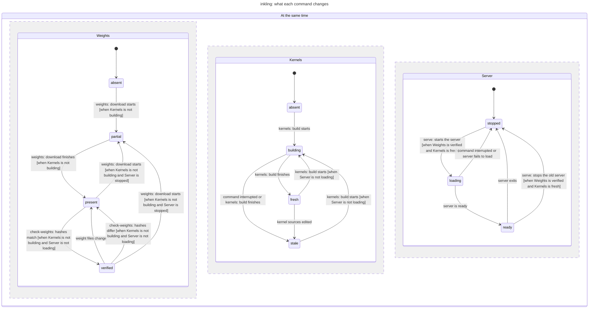

# How the commands are kept hard to misuse

`scripts/inkling.py` runs the whole workflow: `weights`, `check-weights`, `kernels`, `build`, `serve` and `stop`.
Each command checks the state it needs and refuses, naming the next step, instead of failing later. The rules were
written down as a [TLA+ model](InklingLifecycle.tla) and checked with TLC before the tool was written. The model has
two terminals running commands at the same time, files that change at any moment, and commands that are
interrupted.

`doctor` and `status` only read state, so they are not part of the model.

## The rules

| Rule | Meaning | Where the tool enforces it |
| --- | --- | --- |
| `SingleServer` | There is never more than one server of this repository, so `serve` replaces the running one | `serve` stops this repository's server under the command lock, then starts one. A server of another copy of inkling is never stopped |
| `ServersStartedWithPrereqs` | A server only starts with verified weights and kernels that match the sources | `serve_checks`, run before the old server is stopped and again right before the new one starts |
| `NoWriteWhileLoading` | Nothing rewrites the weights or the kernels while a server is loading them | The command lock is held from the first check until `/health` is ready. `weights` also refuses while a server runs |
| `FreshMeansCurrent` | The kernels are never marked fresh if their sources changed after the build began | `build-stamp.json` is deleted when a build starts and written last, and only if the source hash did not change |
| `VerifiedMeansCurrent` | The weights are never marked verified if the files changed after the check began | `check-weights` records file sizes and times, hashes, and records "verified" only if they did not change |
| `OnlyLockHolderRuns` | Only the command holding the lock is past its checks | `logs/inkling.lock`. Windows releases it if a command dies, so there is no stale lock to clear |

The lock is a plain per-repository command lock, so two terminals cannot, for example, start two servers or
overwrite each other's download or build. It does not queue or share the GPU.

## What a user sees

One terminal, projected onto the weights, the kernels and the server. An arrow's bracket is the condition that the
other regions must meet.



Reading it: `serve` starts a server only "when Weights is verified and Kernels is fresh"; a kernel build cannot
start while the server is loading; a weights download starts only while no server runs. (The brackets "when
Kernels is not building" and similar come from one terminal running one command at a time.)

## What the model shows

| Configuration | Result |
| --- | --- |
| `full.cfg` (the design) | All rules hold, and there is no deadlock, across 3,820 states with two terminals |
| `no-lock.cfg` (commands may overlap) | `SingleServer` and `NoWriteWhileLoading` break: two terminals can start two servers, and a build can overwrite the kernels while a server reads them |
| `no-check.cfg` (`serve` does not check) | `ServersStartedWithPrereqs` breaks in 4 steps (a server starts with nothing built), and `NoWriteWhileLoading` breaks (it loads a half-downloaded checkpoint) |

Rerun it with TLC (Java 11 or later; [tla2tools.jar](https://github.com/tlaplus/tlaplus/releases)):

```powershell
java -XX:+UseParallelGC -cp tla2tools.jar tlc2.TLC -config full.cfg InklingLifecycle.tla
```

## What the model assumes

* The check and the start of the server are one step. In reality a few milliseconds pass between them, so `serve`
  checks twice: before it stops the old server and again right before it starts the new one.
* A server reads the weights and the kernels only while it loads, which is while the lock is held.
* Two terminals are modeled. The rules do not depend on the number.
* Whether a hash check passes is not decided by the model; both outcomes are explored.
* The quick "has it changed" test compares file sizes and modification times. A program that rewrites a file
  without changing either defeats it; run `check-weights` after such a change, because it hashes the files.
